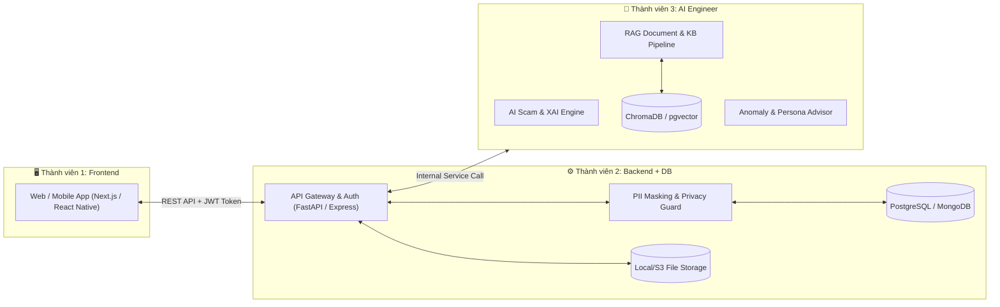

# 🛡️ FinGuard AI – TÀI LIỆU THIẾT KẾ KIẾN TRÚC, PHÂN CHIA NHIỆM VỤ & MOCK SPECS
> **Dành cho Nhóm phát triển 3 người (Frontend | Backend + DB | AI Engineer)**  
> **Dự án:** FinGuard AI – Your Intelligent Financial Guardian (MoMo Hackathon)

---

## 📌 MỤC LỤC
1. [Nguyên tắc phối hợp & Khung kiến trúc 3 Role](#1-nguyên-tắc-phối-hợp--khung-kiến-trúc-3-role)
2. [Bảng phân công nhiệm vụ chi tiết theo 5 Phân hệ](#2-bảng-phân-công-nhiệm-vụ-chi-tiết-theo-5-phân-hệ)
3. [Cấu trúc thư mục mã nguồn (Project Folder Structure)](#3-cấu-trúc-thư-mục-mã-nguồn-project-folder-structure)
4. [Thiết kế Cơ sở Dữ liệu (Database Schema)](#4-thiết-kế-cơ-sở-dữ-liệu-database-schema)
5. [Đặc tả Mock API Contracts & Mock Data mẫu](#5-đặc-tả-mock-api-contracts--mock-data-mẫu)
6. [Đặc tả Màn hình & Thành phần UI (Frontend Mocks)](#6-đặc-tả-màn-hình--thành-phần-ui-frontend-mocks)
7. [Lộ trình triển khai Hackathon (Sprint Execution Plan)](#7-lộ-trình-triển-khai-hackathon-sprint-execution-plan)

---

## 1. NGUYÊN TẮC PHỐI HỢP & KHUNG KIẾN TRÚC 3 ROLE

Dự án áp dụng mô hình **Contract-First Development (Phát triển theo hợp đồng API trước)**. Nhờ có bộ Mock Data này:
* **Frontend** có thể dựng xong toàn bộ giao diện, hiệu ứng và flow người dùng ngay từ ngày đầu tiên bằng cách gọi Mock JSON mà không cần đợi Backend/AI.
* **Backend + DB** tập trung xây dựng mô hình dữ liệu, xác thực (Auth), mã hóa/che dữ liệu nhạy cảm (PII Sanitization) và cổng Gateway.
* **AI Engineer** tập trung build độc lập các pipeline: OCR, Scam Prompt Chains, RAG bóc tách tài liệu, Anomaly Detection và Persona Engine, sau đó bọc thành các hàm service/endpoint sạch sẽ bàn giao cho Backend.



---

## 2. BẢNG PHÂN CÔNG NHIỆM VỤ CHI TIẾT THEO 5 PHÂN HỆ

| Phân hệ chức năng | Thành viên 1: Frontend | Thành viên 2: Backend + Database | Thành viên 3: AI Engineer |
| :--- | :--- | :--- | :--- |
| **Phân hệ 1: AI Scam Intelligence** | • Màn hình Quét: Paste text, upload ảnh chụp chat (drag & drop), nhập URL.<br>• Component hiển thị: Thang điểm rủi ro (Gauge chart), bôi đậm từ ngữ thao túng tâm lý (XAI badge tags). | • API tiếp nhận file/text, lưu lịch sử quét vào DB.<br>• Tích hợp thư viện kiểm tra URL (Whois, domain age, threat intelligence API). | • Pipeline OCR bóc tách chữ tiếng Việt từ ảnh chụp chat.<br>• Prompt Engineering cho LLM phân tích kịch bản thao túng tâm lý đa bước (Multi-turn).<br>• Trả về output JSON có cấu trúc chuẩn Explainable AI (XAI). |
| **Phân hệ 2: Financial Risk & User Persona** | • Màn hình Dashboard tài chính: Biểu đồ phân bổ thu chi, Radar cảnh báo biến động lạ.<br>• Biểu đồ Burn-rate tốc độ đốt ngân sách theo ngày trong tháng. | • Schema & CRUD Transaction (thu/chi/danh mục).<br>• Bảng lưu trữ hồ sơ đặc trưng User Persona.<br>• Batch job / Query tính toán tổng hợp số dư và hạn mức chi. | • Thuật toán **Anomaly Detection** (Isolation Forest hoặc Rule-based z-score) tìm giao dịch lệch chuẩn.<br>• Pipeline trích xuất đặc trưng người dùng: khẩu vị rủi ro, ngưỡng an toàn ví tiền, thói quen chi tiêu. |
| **Phân hệ 3: RAG Document & Knowledge** | • Kho tài liệu mẫu (Thư viện quy định/cảnh báo sẵn có).<br>• Giao diện upload tài liệu PDF/Doc/ảnh hợp đồng cá nhân.<br>• Khung chat Q&A tương tác trực tiếp với tài liệu kèm trích dẫn số trang/điều khoản. | • API tiếp nhận upload file tài liệu, quản lý metadata, lưu file storage.<br>• Quản lý quyền tài liệu (tài khoản nào chỉ xem được tài liệu người đó). | • Pipeline RAG: Chunking văn bản tiếng Việt, Vector Embedding, lưu Vector Store.<br>• Prompt phát hiện **"Bẫy chữ nhỏ"** (lãi suất thả nổi, phí phạt trả trước, điều khoản mập mờ).<br>• Trả về câu trả lời kèm `citations` (trích dẫn căn cứ). |
| **Phân hệ 4: Intelligent Assistant & Incident Builder** | • Widget "Trợ lý Cố vấn Quyết định": Nhập dự định chi $\rightarrow$ nhận khuyến nghị tức thì.<br>• Màn hình "Báo cáo sự cố": Xem dòng thời gian vụ việc, nút xuất PDF/Bản in chuẩn mẫu. | • Endpoint tổng hợp dữ liệu sự cố (logs chat + giao dịch bị lừa + thời gian) thành format Báo cáo.<br>• Logic kết nối tín hiệu kép (Contextual Risk: có scan scam + có biến động tiền). | • Prompt tổng hợp: Kết hợp [Dự định chi/Gói tài chính] + [Hồ sơ Persona] để sinh lời khuyên cá nhân hóa.<br>• LLM Summarization: Tự động viết tóm tắt diễn biến sự việc mạch lạc phục vụ trình báo công an/ngân hàng. |
| **Phân hệ 5: Privacy & Security** | • Màn hình Quản lý Quyền riêng tư & Bảo mật: Nút "Xóa toàn bộ dữ liệu của tôi", toggle chia sẻ dữ liệu.<br>• UI ẩn thông tin nhạy cảm (Masking toggle: hiển thị `**** 1234`). | • Module Auth (JWT, refresh token, bcrypt password).<br>• **PII Sanitizer Middleware:** Tự động che số tài khoản, CCCD, SĐT trước khi lưu hoặc gửi đi AI.<br>• Bảng Audit Logs ghi nhận sự kiện hệ thống. | • **AI Guardrail:** Kiểm tra và chặn prompt injection, đảm bảo LLM không làm lộ dữ liệu của user khác trong RAG.<br>• Xử lý triệt để việc không đưa dữ liệu nhạy cảm của người dùng vào context công khai. |

---

## 3. CẤU TRÚC THƯ MỤC MÃ NGUỒN (PROJECT FOLDER STRUCTURE)

Dự án được cấu trúc theo dạng Monorepo gọn gàng, mỗi thành viên sở hữu 1 thư mục chính:

```text
finguard_ai_momohackathon2026/
├── docs/                               # Tài liệu thiết kế, API specs, sơ đồ
│   └── FINGUARD_ARCHITECTURE_AND_MOCK.md
├── frontend/                           # [THÀNH VIÊN 1: FRONTEND]
│   ├── src/
│   │   ├── components/                 # Các component tái sử dụng (Button, Modal, Card...)
│   │   │   ├── scam/                   # GaugeMeter, HighlightedText, UrlInspector
│   │   │   ├── finance/                # TransactionChart, AnomalyCard, BurnRateBar
│   │   │   ├── rag/                    # DocumentViewer, TrapAlertList, DocChatBox
│   │   │   └── assistant/              # DecisionAdvisorCard, IncidentReportModal
│   │   ├── pages/ (hoặc app/)          # Các màn hình chính (Dashboard, Scan, Finance, Doc, Incident)
│   │   ├── services/                   # Gọi API Backend (kèm mock toggle)
│   │   │   ├── api.js                  # Axios client cấu hình base URL & JWT
│   │   │   └── mockData/               # Dữ liệu Mock JSON dùng khi chưa nối backend
│   │   │       ├── mockScam.json
│   │   │       ├── mockFinance.json
│   │   │       ├── mockRag.json
│   │   │       └── mockAdvisor.json
│   │   └── styles/                     # Tailwind CSS / Styles
│   ├── package.json
│   └── README.md
│
├── backend/                            # [THÀNH VIÊN 2: BACKEND + DB]
│   ├── src/
│   │   ├── controllers/                # Tiếp nhận request & điều phối
│   │   ├── services/                   # Nghiệp vụ backend, gọi sang AI Engine
│   │   ├── middlewares/                # Auth middleware, PII Sanitizer, AuditLogger
│   │   ├── models/                     # Database Models (ORM: Prisma / SQLAlchemy / Mongoose)
│   │   ├── routes/                     # Định nghĩa router REST API
│   │   │   ├── auth.routes.js (py)
│   │   │   ├── scam.routes.js
│   │   │   ├── finance.routes.js
│   │   │   ├── rag.routes.js
│   │   │   └── incident.routes.js
│   │   └── utils/                      # Mã hóa, export PDF, helper
│   ├── .env.example
│   ├── requirements.txt (hoặc package.json)
│   └── README.md
│
└── ai_engine/                          # [THÀNH VIÊN 3: AI ENGINEER]
    ├── pipelines/
    │   ├── ocr_pipeline.py             # Trích xuất văn bản từ ảnh chụp màn hình
    │   ├── scam_analyzer.py            # Phân tích kịch bản lừa đảo & thao túng tâm lý
    │   ├── rag_engine.py               # Vectorize, Retriver, Bóc tách "bẫy chữ nhỏ"
    │   ├── anomaly_detector.py         # Phát hiện dị biệt dòng tiền & tính Burn-rate
    │   └── persona_advisor.py          # Ghép Persona + Giao dịch để gợi ý quyết định
    ├── knowledge_base/                 # Dữ liệu tài liệu mẫu nạp sẵn (luật, thủ đoạn scam)
    │   ├── ncsc_scam_handbook.pdf
    │   └── banking_safety_rules.txt
    ├── prompts/                        # System prompts chuẩn hóa cho LLM
    │   ├── scam_detect_prompt.py
    │   ├── trap_extraction_prompt.py
    │   └── advisor_prompt.py
    ├── vector_store/                   # Thư mục lưu ChromaDB / Faiss local
    └── server.py                       # FastAPI phục vụ các internal endpoints cho Backend gọi
```

---

## 4. THIẾT KẾ CƠ SỞ DỮ LIỆU (DATABASE SCHEMA)

Dưới đây là thiết kế chuẩn các bảng dữ liệu cho **Thành viên 2 (Backend)** triển khai trên PostgreSQL / MongoDB:

```mermaid
erDiagram
    USERS ||--o{ TRANSACTIONS : "owns"
    USERS ||--o| USER_PERSONAS : "has profile"
    USERS ||--o{ SCAM_SCANS : "performs"
    USERS ||--o{ USER_DOCUMENTS : "uploads"
    USERS ||--o{ INCIDENT_REPORTS : "creates"
    USERS ||--o{ AUDIT_LOGS : "generates"

    USERS {
        uuid id PK
        string email UK
        string password_hash
        string full_name
        string phone_masked
        timestamp created_at
    }

    USER_PERSONAS {
        uuid id PK
        uuid user_id FK
        decimal monthly_income
        decimal safe_spending_limit
        string risk_appetite "LOW / MODERATE / HIGH"
        json spending_habits "Nhóm hay chi tiêu"
        timestamp updated_at
    }

    TRANSACTIONS {
        uuid id PK
        uuid user_id FK
        decimal amount
        string category "Ăn uống, Mua sắm, Đầu tư..."
        string description
        boolean is_anomaly "Đánh dấu bất thường"
        string anomaly_reason
        timestamp transaction_time
    }

    SCAM_SCANS {
        uuid id PK
        uuid user_id FK
        string input_type "TEXT / IMAGE / URL"
        text original_content_masked
        integer risk_score "0 - 100"
        string risk_level "SAFE / SUSPICIOUS / CRITICAL"
        json manipulation_tactics "Các bẫy tâm lý"
        json xai_explanation "Căn cứ giải thích"
        timestamp scanned_at
    }

    USER_DOCUMENTS {
        uuid id PK
        uuid user_id FK
        string doc_name
        string file_url
        string doc_type "LOAN_CONTRACT / CREDIT_TERMS / INVESTMENT_PROPOSAL"
        json hidden_traps "Danh sách bẫy chữ nhỏ"
        json summary_points
        timestamp uploaded_at
    }

    INCIDENT_REPORTS {
        uuid id PK
        uuid user_id FK
        string incident_code UK
        string status "DRAFT / EXPORTED / SUBMITTED"
        json timeline_events "Dòng thời gian sự việc"
        json attached_scams "IDs của scan liên quan"
        json attached_transactions "IDs của giao dịch bị mất tiền"
        text ai_generated_summary
        timestamp created_at
    }

    AUDIT_LOGS {
        uuid id PK
        uuid user_id FK
        string action "LOGIN / DATA_DELETE / SCAN / EXPORT"
        string ip_address_masked
        timestamp created_at
    }
```



---

## 5. ĐẶC TẢ MOCK API CONTRACTS & MOCK DATA MẪU

Dưới đây là các API chính được định nghĩa sẵn. **Thành viên 1** lưu các JSON này vào `frontend/src/services/mockData/` để dev UI ngay lập tức. **Thành viên 2 & 3** cam kết dựng API theo đúng schema này.

---

### API 1: Quét Lừa đảo & Thao túng tâm lý
* **Endpoint:** `POST /api/v1/scam/scan`
* **Mô tả:** Nhận nội dung tin nhắn, URL hoặc ảnh để phân tích đa chiều.

#### Request Body:
```json
{
  "type": "TEXT", // "TEXT" | "URL" | "IMAGE_OCR"
  "content": "Em là cán bộ phòng CSGT, thông báo anh/chị có biên phạt nguội 5.000.000đ vi phạm giao thông. Bấm vào link http://tra-cuu-phat-nguoi-cand.online/pay để nộp ngay trong 24h, nếu không sẽ khóa tài khoản ngân hàng và khởi tố hình sự!",
  "context": "Tin nhắn từ số điện thoại lạ +84988xxxxxx qua Zalo"
}
```

#### Mock Response (200 OK):
```json
{
  "scan_id": "scam_scan_98231",
  "risk_score": 92,
  "risk_level": "CRITICAL", // "SAFE" (0-30) | "SUSPICIOUS" (31-70) | "CRITICAL" (71-100)
  "summary": "Phát hiện kịch bản giả mạo Cơ quan Công an và đe dọa pháp lý khẩn cấp nhằm chiếm đoạt tài sản.",
  "psychological_manipulation": [
    {
      "tactic": "Authority Impersonation (Mạo danh quyền lực)",
      "evidence": "Em là cán bộ phòng CSGT...",
      "explanation": "Kẻ gian tự xưng là cán bộ công an để gây áp lực phục tùng."
    },
    {
      "tactic": "Fear Inducement & False Urgency (Tạo sợ hãi & Gấp gáp ảo)",
      "evidence": "...nộp ngay trong 24h, nếu không sẽ khóa tài khoản và khởi tố...",
      "explanation": "Tạo tâm lý hoảng loạn, khiến nạn nhân không kịp kiểm chứng thông tin."
    }
  ],
  "url_analysis": {
    "url": "http://tra-cuu-phat-nguoi-cand.online/pay",
    "is_phishing": true,
    "domain_age_days": 3,
    "warning": "Tên miền đuôi .online mới đăng ký 3 ngày trước, giả mạo Cổng thông tin CAND (tên miền chính thức của nhà nước phải có đuôi .gov.vn)."
  },
  "actionable_checklist": [
    "TUYỆT ĐỐI KHÔNG truy cập vào đường link nói trên.",
    "Cơ quan Công an KHÔNG làm việc, thu tiền phạt nguội qua tin nhắn Zalo/SMS.",
    "Nếu cần kiểm tra phạt nguội, hãy vào website chính thức: csgt.vn.",
    "Chặn và báo cáo số điện thoại/tài khoản này."
  ]
}
```

---

### API 2: Phân tích Tài liệu RAG & Bóc tách "Bẫy chữ nhỏ"
* **Endpoint:** `POST /api/v1/rag/analyze-document`
* **Mô tả:** Người dùng tải hợp đồng vay, điều khoản mở thẻ hoặc gói đầu tư để trích xuất rủi ro.

#### Mock Response (200 OK):
```json
{
  "document_id": "doc_loan_4412",
  "document_name": "Hop_Dong_Vay_Tieu_Dung_Nhanh.pdf",
  "doc_type": "LOAN_CONTRACT",
  "risk_rating": "HIGH_RISK",
  "summary": "Hợp đồng vay tiêu dùng hạn mức 30.000.000đ trong 12 tháng. Có nhiều điều khoản bất lợi về lãi suất thả nổi và biểu phí phạt mập mờ.",
  "hidden_traps": [
    {
      "category": "Lãi suất ngầm",
      "clause_snippet": "Lãi suất ưu đãi 0.99%/tháng cho 3 tháng đầu, sau đó áp dụng biểu phí điều chỉnh theo chính sách từng thời kỳ.",
      "trap_warning": "BẪY LÃI THẢ NỔI: Sau 3 tháng đầu, lãi suất thực tế có thể vọt lên 45% - 60%/năm nhưng không được ghi rõ con số trần."
    },
    {
      "category": "Phí tất toán trước hạn",
      "clause_snippet": "Bên vay nếu thanh toán trước thời hạn sẽ chịu phí vi phạm hợp đồng tương đương 15% trên dư nợ còn lại.",
      "trap_warning": "PHÍ PHẠT CAO: Mức phí tất toán 15% cao hơn gấp 3 lần so với mức thông lệ thị trường (thường là 3-5%)."
    }
  ],
  "suggested_questions": [
    "Tổng số tiền lãi và gốc tôi phải trả sau 12 tháng là bao nhiêu?",
    "Nếu tôi chậm trả 3 ngày thì bị tính phí phạt thế nào?",
    "Hợp đồng này có cho phép bên cho vay gọi điện cho người thân không?"
  ]
}
```

---

### API 3: Gợi ý Quyết định & Chi tiêu theo Đặc trưng User (Persona Advisor)
* **Endpoint:** `POST /api/v1/advisor/decision`
* **Mô tả:** Kết hợp dự định chi tiêu hoặc gói tài chính với túi tiền của user để tư vấn.

#### Request Body:
```json
{
  "proposed_action": "SPENDING", // "SPENDING" | "INVESTMENT" | "BORROWING"
  "amount": 4200000,
  "category": "Mua sắm / Điện tử",
  "notes": "Dự định mua tai nghe Bluetooth mới bằng hình thức trả góp 3 tháng",
  "linked_document_id": null
}
```

#### Mock Response (200 OK):
```json
{
  "advice_id": "adv_9921",
  "recommendation": "CAUTION_HOLD", // "PROCEED" | "CAUTION_HOLD" | "STRONGLY_DISCOURAGED"
  "headline": "Cân nhắc hoãn khoản chi này sang tháng sau để tránh hụt ngân sách thiết yếu!",
  "personalized_analysis": {
    "current_budget_status": "Ngân sách Mua sắm tháng này của bạn còn lại 1.200.000đ. Khoản chi 4.200.000đ sẽ làm vượt hạn mức an toàn 250%.",
    "upcoming_obligations": "Dựa trên lịch sử chu kỳ của bạn, vào ngày 28 hàng tháng bạn cần thanh toán tiền thuê nhà (4.500.000đ) và hóa đơn điện nước (800.000đ).",
    "emergency_fund_impact": "Nếu chi ngay hôm nay, quỹ dự phòng khẩn cấp của bạn sẽ giảm xuống mức báo động (chỉ còn đủ trang trải 10 ngày sinh hoạt)."
  },
  "action_options": [
    {
      "option": "Trì hoãn mua sắm",
      "description": "Đợi sau ngày 05 tháng sau (sau khi nhận lương) để không ảnh hưởng tiền nhà."
    },
    {
      "option": "Chia nhỏ trả góp 6 tháng 0%",
      "description": "Mỗi tháng chỉ trích 700.000đ, vẫn nằm trong hạn mức an toàn của bạn."
    }
  ]
}
```

---

### API 4: Bắt Biến động Bất thường trong Dòng tiền (Anomaly Detection)
* **Endpoint:** `GET /api/v1/finance/anomalies`

#### Mock Response (200 OK):
```json
{
  "period": "LAST_30_DAYS",
  "anomaly_count": 2,
  "burn_rate": {
    "days_passed_percent": 40,
    "budget_spent_percent": 72,
    "status": "FAST_BURN_WARNING",
    "message": "Bạn đã tiêu hết 72% ngân sách tháng dù mới qua 12 ngày!"
  },
  "anomalies": [
    {
      "transaction_id": "tx_8812",
      "amount": 2500000,
      "recipient": "NGUYEN VAN X - MB BANK",
      "timestamp": "2026-11-23T02:15:00Z",
      "reason": "Giao dịch số tiền lớn phát sinh vào khung giờ 2:15 sáng (lệch hoàn toàn so với lịch sử sinh hoạt của bạn)."
    },
    {
      "transaction_id": "tx_8815",
      "amount": 99000,
      "recipient": "GLOBAL_DIGITAL_SERVICES_HK",
      "timestamp": "2026-11-23T08:30:00Z",
      "reason": "Giao dịch lặp lại lần thứ 4 trong tuần với số tiền nhỏ cố định tới dịch vụ nước ngoài (dấu hiệu rò rỉ thông tin thẻ)."
    }
  ]
}
```

---

### API 5: Tạo & Đóng gói Hồ sơ Sự cố Tự động
* **Endpoint:** `POST /api/v1/incidents/create-report`

#### Mock Response (200 OK):
```json
{
  "incident_code": "INC-20261124-998",
  "status": "READY_FOR_EXPORT",
  "generated_at": "2026-11-24T10:35:00Z",
  "victim_info": {
    "name": "Nguyễn Văn A",
    "masked_phone": "098****123"
  },
  "executive_summary": "Vụ việc lừa đảo mạo danh ngân hàng nâng hạn mức thẻ tín dụng. Nạn nhân nhận tin nhắn SMS Brandname giả mạo, truy cập link phishing và bị trừ tiền qua 2 giao dịch trái phép.",
  "total_financial_loss": 8500000,
  "timeline": [
    {"time": "09:15 - 24/11/2026", "event": "Nhận SMS Brandname giả mạo báo 'Thẻ tín dụng được duyệt nâng hạn mức 50 triệu'."},
    {"time": "09:22 - 24/11/2026", "event": "Truy cập đường link https://momo-support-upgrade.xyz và nhập thông tin tài khoản."},
    {"time": "09:25 - 24/11/2026", "event": "Tài khoản bị trừ 5.000.000đ tới tài khoản nhận NGUYEN VAN B - STK: 1029384756."},
    {"time": "09:28 - 24/11/2026", "event": "Tài khoản tiếp tục bị trừ 3.500.000đ."}
  ],
  "evidence_files": [
    "evidence_sms_screenshot.png",
    "evidence_phishing_url_whois.json",
    "bank_statement_extract.pdf"
  ],
  "download_pdf_url": "/api/v1/incidents/INC-20261124-998/download-pdf"
}
```

---

## 6. ĐẶC TẢ MÀN HÌNH & THÀNH PHẦN UI (FRONTEND MOCKS)

Dành cho **Thành viên 1 (Frontend)** dễ dàng hình dung và phân bổ component:

```text
┌────────────────────────────────────────────────────────────────────────┐
│                        📱 FINGUARD AI MOBILE/WEB                       │
├────────────────────────────────────────────────────────────────────────┤
│  [Top Bar]  🔔 Thông báo (2 bất thường)       👤 Hồ sơ: User Thận trọng │
├────────────────────────────────────────────────────────────────────────┤
│  🛡️ CHỈ SỐ AN TOÀN TÀI CHÍNH: 85/100 (An Toàn)                         │
│  [=====================================>         ]                     │
├────────────────────────────────────────────────────────────────────────┤
│  ⚡ QUICK ACTIONS:                                                      │
│  ┌──────────────────┐  ┌──────────────────┐  ┌───────────────────────┐ │
│  │ 🔍 Quét Scam/URL │  │ 📄 Phân tích HĐ  │  │ 💡 Hỏi Cố vấn chi tiêu│ │
│  └──────────────────┘  └──────────────────┘  └───────────────────────┘ │
├────────────────────────────────────────────────────────────────────────┤
│  🚨 RADAR CẢNH BÁO MỚI NHẤT (Financial Anomaly):                       │
│  ⚠️ Phát hiện 1 khoản chi lạ 2.500.000đ lúc 02:15 sáng nay             │
│  [Xem chi tiết & Xác nhận]   [Khóa thẻ khẩn cấp]                       │
├────────────────────────────────────────────────────────────────────────┤
│  📊 TÌNH TRẠNG NGÂN SÁCH (Burn-rate):                                  │
│  Đã tiêu: 7.200.000đ / 10.000.000đ (72%) - Cảnh báo: Tiêu nhanh!      │
│  [██████████████████████░░░░░░░] Ngày 12/30                            │
├────────────────────────────────────────────────────────────────────────┤
│  🤖 TRỢ LÝ HỎI ĐÁP CÁ NHÂN HÓA:                                       │
│  "Tháng này tôi có nên mua xe máy trả góp 3 triệu/tháng không?"        │
│  👉 AI trả lời: "Dựa vào thu nhập 15tr và chi phí cố định của bạn..."   │
├────────────────────────────────────────────────────────────────────────┤
│  [Bottom Nav]  🏠 Trang chủ | 🛡️ Quét Scam | 📄 Tài liệu | 👤 Bảo mật    │
└────────────────────────────────────────────────────────────────────────┘
```

---

## 7. LỘ TRÌNH TRIỂN KHAI HACKATHON (SPRINT EXECUTION PLAN)

| Mốc thời gian | Thành viên 1: Frontend | Thành viên 2: Backend + DB | Thành viên 3: AI Engineer |
| :--- | :--- | :--- | :--- |
| **Ngày 1: Chốt Mock & Dựng móng** | • Tạo khung app (Next.js/React).<br>• Import mock JSON vào `services/mockData`.<br>• Dựng UI Màn hình Quét Scam & Dashboard. | • Khởi tạo project Backend (FastAPI).<br>• Dựng DB Schema trên PostgreSQL/Docker.<br>• Viết API Auth & CRUD mock endpoints. | • Dựng prompt template cho Scam & XAI.<br>• Cài đặt ChromaDB và nạp 2 tài liệu mẫu.<br>• Viết script test trích xuất "bẫy chữ nhỏ". |
| **Ngày 2: Ráp nối & Hoàn thiện luồng** | • Dựng Màn hình RAG Tài liệu & Chat Q&A.<br>• Dựng Màn hình Báo cáo Sự cố (Incident).<br>• Bật toggle chuyển từ Mock sang gọi API thật. | • Tích hợp middleware che dữ liệu PII.<br>• Viết logic kết nối API Gateway sang AI Service.<br>• Viết chức năng xuất PDF Báo cáo sự cố. | • Đóng gói FastAPI internal endpoints (Scam, RAG, Anomaly, Persona).<br>• Viết bộ quy tắc Anomaly Detection.<br>• Tối ưu tốc độ phản hồi (Streaming response). |
| **Ngày 3: Test, Demo & Đóng gói Pitch** | • Tút lại UI/UX, thêm animations, toast cảnh báo.<br>• Chuẩn bị slide và flow demo trực tiếp trên màn hình. | • Test tải, kiểm tra bảo mật API, seed dữ liệu demo kịch tính cho ban giám khảo. | • Tinh chỉnh Prompt để AI trả lời tiếng Việt tự nhiên, thuyết phục, bám sát Persona. |
